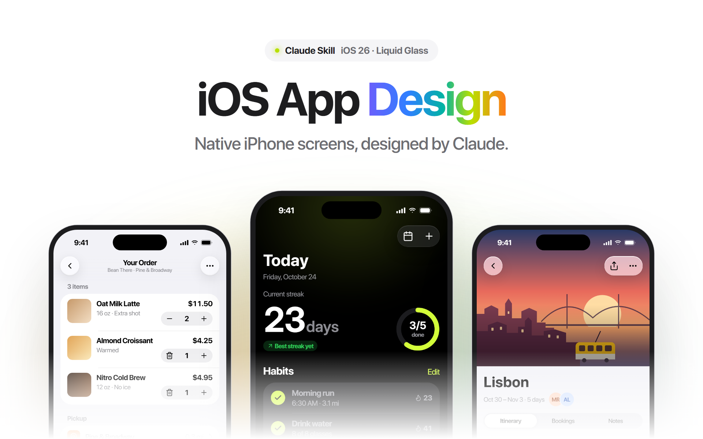
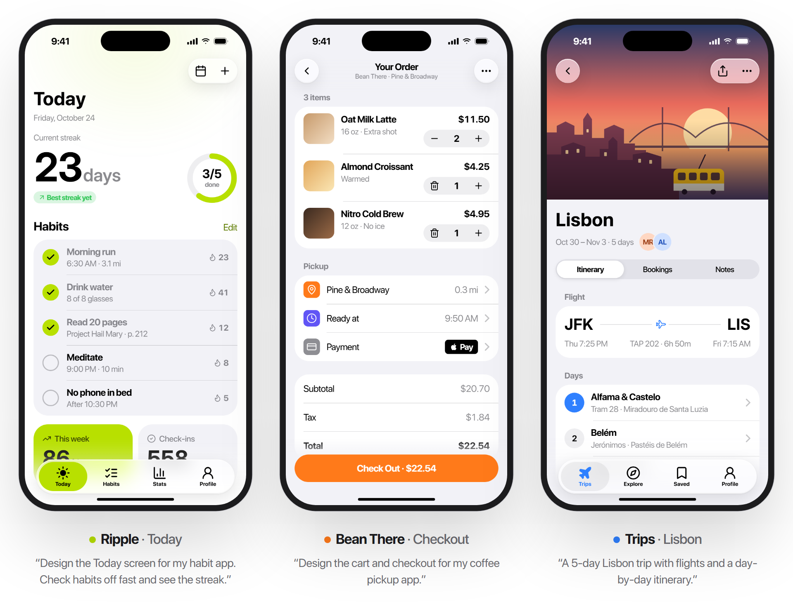
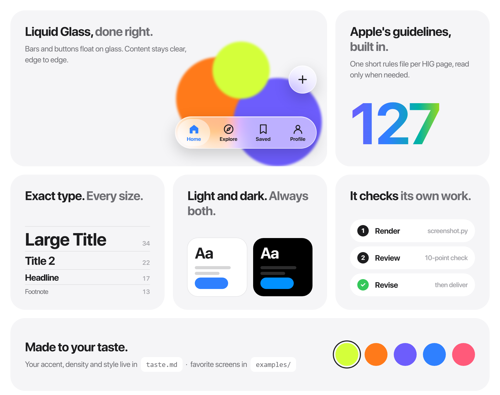

<p align="center">
  <picture>
    <source media="(prefers-color-scheme: dark)" srcset=".github/readme/hero-dark.png">
    
  </picture>
</p>

<p align="center">
  A Claude skill that turns an app idea into polished iPhone screens.<br>
  Built on Apple's Human Interface Guidelines for iOS&nbsp;26 and Liquid&nbsp;Glass.
</p>

<p align="center">
  <a href="#install"><b>Install</b></a>&nbsp;&nbsp;·&nbsp;&nbsp;
  <a href="#just-describe-your-app"><b>Gallery</b></a>&nbsp;&nbsp;·&nbsp;&nbsp;
  <a href="#how-it-works"><b>How it works</b></a>&nbsp;&nbsp;·&nbsp;&nbsp;
  <a href="#make-it-yours"><b>Make it yours</b></a>
</p>

<br>

## Just describe your app.

No wireframes. No Figma file. Tell Claude what the app does, and it designs the screen the way Apple's own apps are built: large titles, floating glass bars, inset lists, real content. Every screen comes back as an HTML mockup in an iPhone 17 Pro frame, plus a PNG.

<picture>
  <source media="(prefers-color-scheme: dark)" srcset=".github/readme/gallery-dark.png">
  
</picture>

<br>

## Everything iOS. In one skill.

<picture>
  <source media="(prefers-color-scheme: dark)" srcset=".github/readme/features-dark.png">
  
</picture>

<br>

## Install.

Clone into your Claude skills folder. That's it.

```bash
git clone https://github.com/Muhon33/ios-app-design ~/.claude/skills/ios-app-design
```

Then ask for a screen:

> Design a settings screen for my running app.
>
> Mock up onboarding for a budgeting app. Three pages, dark.
>
> Here's a screenshot of my profile screen. What would Apple change?

The skill starts on its own whenever you ask for an iPhone app, screen or flow.

**Requirements:** Python 3 and Chrome or Edge. The skill uses them to screenshot each design before handing it over.

<br>

## How it works.

1. **Frame the job.** Who the screen is for, its one main task, and two or three secondary actions.
2. **Pick the structure first.** Tab bar, navigation stack, sheet or full-screen modal, chosen from a decision table, before any pixels.
3. **Look up the rules.** It opens only the few HIG files the screen needs (tab bars, sheets, buttons…) out of 127.
4. **Build from the kit.** A template and `ios.css` give it the exact iOS type scale, system colors, 16 pt margins, glass controls and safe areas.
5. **Render, look, fix.** It screenshots the design in light and dark, reviews it against a 10-point checklist, and revises.
6. **Deliver.** HTML and PNG, with a short note on the structure, any assumptions, and ideas for next screens.

<br>

## Make it yours.

| File | What it does |
|:--|:--|
| [`taste.md`](taste.md) | Your style. Accent colors, density, light or dark first, apps you love. It overrides the defaults. |
| [`examples/`](examples/) | Screens you admire, with a note on each in [`notes.md`](examples/notes.md). The skill copies their qualities, never their layouts. |
| [`anti-patterns.md`](anti-patterns.md) | Mistakes to avoid. It grows each time a design needs fixing. |

<br>

## What's inside.

```
ios-app-design/
├── SKILL.md               The workflow and design principles
├── taste.md               Your preferences
├── anti-patterns.md       Known mistakes and their fixes
├── assets/
│   ├── ios.css            iOS 26 tokens and components
│   └── template.html      iPhone frame starter
├── references/
│   ├── tokens.md          Type, color, spacing and radius tables
│   ├── components.md      HTML recipes for every component
│   ├── screen-patterns.md Proven layouts by screen type
│   └── hig/               127 Human Interface Guidelines rule files
├── examples/              Reference screens and notes
├── scripts/
│   └── screenshot.py      Renders a mockup to PNG
└── evals/                 Test prompts with graders
```

<br>

## Evals.

[`evals/`](evals/) holds three test cases: a habit tracker, a coffee checkout and a trip detail screen. Each has a prompt and a set of graders that check for native navigation, dark mode, realistic content and one clear primary action. Use them to check the skill after you change it.

<br>

<details>
<summary><b>Rebuild the README images</b></summary>
<br>

The images on this page were designed with the skill itself. Their sources are in [`.github/readme/src/`](.github/readme/src/). From the repo root:

```bash
python scripts/screenshot.py .github/readme/src/habit.html --bare --theme dark --out .github/readme/screens/habit-dark.png
```

```bash
python scripts/screenshot.py .github/readme/src/hero.html --theme dark --width 960 --height 600 --out .github/readme/hero-dark.png
```

Render each screen (`habit`, `checkout`, `trip`) in both themes first, then `hero` (960×600), `gallery` (960×730) and `features` (960×760).

</details>

<br>

<p align="center">
  <sub>Not affiliated with Apple Inc. iPhone, iOS and Liquid Glass are trademarks of Apple Inc.<br>The notes in <code>references/hig/</code> are condensed from Apple's public Human Interface Guidelines and link to each source page.</sub>
</p>
